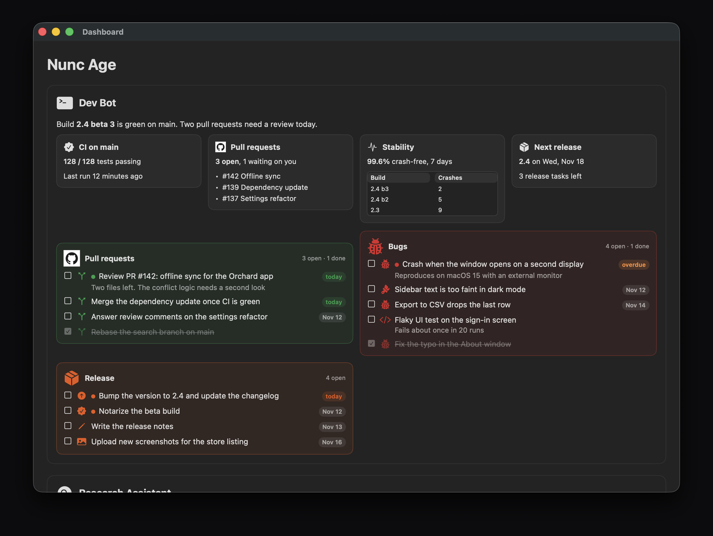
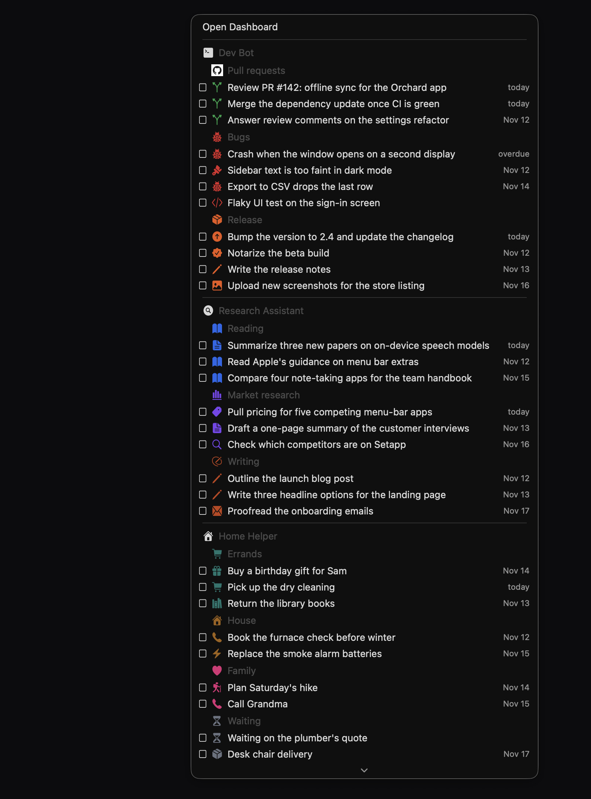

# Nunc Age

Nunc Age is a macOS menu-bar TODO list and dashboard. You tick items in the app; your AI agent (Grok Bot, Cursor, Claude Code, Codex, or another) keeps the lists in a folder of plain CSV and Markdown files.





The menu is a regular macOS menu that grows with its contents. Each agent is a header, then each section, with icons when the agent provided them. The menu shows the first few open items of each section, in the order the agent wrote them (5 per section by default; Settings can show 3, 10, or all). When you tick one, the next open item from that section takes its place, and the menu stays open. The dashboard shows every open item in source and section cards, plus items completed this week (or longer, if Settings says so).

This public repository is for [issues](https://github.com/diligiteiust/NuncAge-App/issues), documentation, and the agent skills. The app source is private.

## Install the skills

There are two skills:

- **nunc-age** — how an agent talks to the app (the folder, the CSV and Markdown files, and tick notifications)
- **nunc-age-starter** — a sample dashboard and a few common lists, so the app is not empty on first launch

### From the app

In Nunc Age 1.1 or later, open Settings and use **Install for agents on this Mac**. That copies both skills into the skill folders of the agents it finds (Cursor, Claude Code, Codex, and the shared `~/.agents/skills` folder). Use **Save a zip** if you need to upload a skill to Claude on the web.

### Grok Bot

Grok Bot runs on its own computer, so nothing is copied onto your Mac for it. In Nunc Age 1.3 or later, Settings has a **Copy prompt** button for Grok Bot. Paste that prompt into a Grok Bot chat. It asks Grok Bot to install both skills from this repository, connect to your Nunc Age data folder, and create your first list.

### From this repository

```sh
npx skills add diligiteiust/NuncAge-App -g
```

That installs the skills for your user account, in every supported agent the installer knows about. You can also clone this repository and copy `skills/nunc-age` and `skills/nunc-age-starter` into your agent's skills folder yourself.

## File format

The contract the app reads is [skills/nunc-age/references/FORMAT.md](skills/nunc-age/references/FORMAT.md). The default data folder is `~/NuncAge`. Lists live in `todos/`, optional section icons and colors in `sections/`, pictures in `icons/`, and a short Markdown note in `dashboard/`. From Nunc Age 1.4, a to-do, a section, or a source can have an icon: a file under `icons/` or an `sf:` SF Symbol. From Nunc Age 1.8, a dashboard note can lay a few facts side by side in a `::: cards` row: each `###` heading is a card, with an optional `{icon}`.

## Support

Please [open an issue](https://github.com/diligiteiust/NuncAge-App/issues) for bugs, questions, and feature requests.
